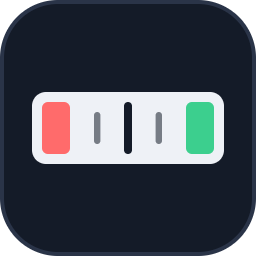
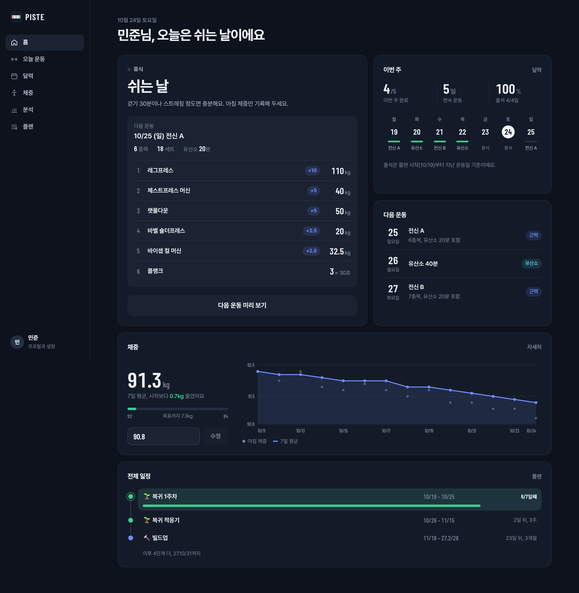

#  PISTE

## 🚀 Overview

**FastAPI + React + Vite** 기반의 **개인용 운동 스케줄러**입니다.  
요일별 플랜에 맞춰 오늘 할 운동과 종목별 추천 무게를 보여 주고, 세트를 기록하면 다음 무게를 **이중 점진법**(모든 세트가 목표 횟수를 채우면 한 단계 증량)으로 정해 줍니다. Docker Compose 한 줄로 PC에 띄우고, 같은 와이파이의 휴대폰으로 헬스장에서 기록합니다. 로그인 없이 이름만으로 시작하는 1인용 앱입니다.

## 🛠️ Built With

<picture>
  <source media="(prefers-color-scheme: dark)" srcset=".github/readme/badges/dark/python.png">
  <source media="(prefers-color-scheme: light)" srcset=".github/readme/badges/light/python.png">
  
</picture>
<picture>
  <source media="(prefers-color-scheme: dark)" srcset=".github/readme/badges/dark/fastapi.png">
  <source media="(prefers-color-scheme: light)" srcset=".github/readme/badges/light/fastapi.png">
  
</picture>
<picture>
  <source media="(prefers-color-scheme: dark)" srcset=".github/readme/badges/dark/postgresql.png">
  <source media="(prefers-color-scheme: light)" srcset=".github/readme/badges/light/postgresql.png">
  
</picture>
<picture>
  <source media="(prefers-color-scheme: dark)" srcset=".github/readme/badges/dark/openapi.png">
  <source media="(prefers-color-scheme: light)" srcset=".github/readme/badges/light/openapi.png">
  
</picture>
<picture>
  <source media="(prefers-color-scheme: dark)" srcset=".github/readme/badges/dark/react.png">
  <source media="(prefers-color-scheme: light)" srcset=".github/readme/badges/light/react.png">
  
</picture>
<picture>
  <source media="(prefers-color-scheme: dark)" srcset=".github/readme/badges/dark/typescript.png">
  <source media="(prefers-color-scheme: light)" srcset=".github/readme/badges/light/typescript.png">
  
</picture>
<picture>
  <source media="(prefers-color-scheme: dark)" srcset=".github/readme/badges/dark/vite.png">
  <source media="(prefers-color-scheme: light)" srcset=".github/readme/badges/light/vite.png">
  
</picture>
<picture>
  <source media="(prefers-color-scheme: dark)" srcset=".github/readme/badges/dark/tanstackquery.png">
  <source media="(prefers-color-scheme: light)" srcset=".github/readme/badges/light/tanstackquery.png">
  
</picture>
<picture>
  <source media="(prefers-color-scheme: dark)" srcset=".github/readme/badges/dark/docker.png">
  <source media="(prefers-color-scheme: light)" srcset=".github/readme/badges/light/docker.png">
  
</picture>
<picture>
  <source media="(prefers-color-scheme: dark)" srcset=".github/readme/badges/dark/nginx.png">
  <source media="(prefers-color-scheme: light)" srcset=".github/readme/badges/light/nginx.png">
  
</picture>
<picture>
  <source media="(prefers-color-scheme: dark)" srcset=".github/readme/badges/dark/vitest.png">
  <source media="(prefers-color-scheme: light)" srcset=".github/readme/badges/light/vitest.png">
  
</picture>
<picture>
  <source media="(prefers-color-scheme: dark)" srcset=".github/readme/badges/dark/playwright.png">
  <source media="(prefers-color-scheme: light)" srcset=".github/readme/badges/light/playwright.png">
  
</picture>

## 🖥️ Preview

<p align="center">
  
</p>

## ✨ Key Features

- **🏋️ 오늘 운동 · 추천 무게**: 요일 계획(근력 · 유산소 · 휴식, 격주 A/B 루틴)에 맞춰 종목별 무게를 추천하고, 처음 하는 종목은 **무게 찾기**(12회 후 남은 개수로 단계 조정)로 시작 무게를 정함
- **⏱️ 운동 모드**: 한 종목씩 크게 보여 주고, 세트를 기록하면 종목별 **휴식 타이머**가 자동으로 돌며(진동 · 소리), 끝나면 세트 · 볼륨 · 신기록 요약
- **📅 달력 · 이번 주**: 계획 대비 완료 · 빠짐 · 못 함, 연속 운동 · 출석률(집계 기준 함께 표시)
- **🗺️ 플랜 편집**: 단계(이름 · 기간 · 추가 · 삭제), 요일 계획, 루틴 구성 · 순서, 종목(근육 13부위 · 증량 단위 · 휴식 시간)을 화면에서 수정. 전체 일정은 단계 로드맵으로 표시
- **⚖️ 체중 · 측정**: 아침 체중과 7일 평균 추세, 목표 체중까지 진행, 월말 둘레 · 체지방 측정
- **📊 분석**: 최근 7일 근육별 세트(주동근 1 · 보조근 0.5), 개인 기록(추정 1RM), 한쪽씩 하는 종목의 좌우 균형
- **🌗 다크 · 라이트 테마**: 데스크톱은 사이드바, 휴대폰은 하단 탭

## 📂 Project Structure

```text
MINI_Piste/
┣━━ 📂 .github/readme/          # README 에셋 (logo, preview, badges)
┣━━ 📂 backend/
┃   ┣━━ 📂 app/
┃   ┃   ┣━━ 📂 api/             # 라우터 (오늘 · 플랜 · 기록 · 측정 · 통계)
┃   ┃   ┣━━ 📂 services/        # 무게 추천 · 날짜별 계획 · 달력 집계 · 통계
┃   ┃   ┣━━ models.py           # SQLAlchemy 모델
┃   ┃   ┣━━ schemas.py          # Pydantic 입출력 (OpenAPI 의 원본)
┃   ┃   ┗━━ seed.py             # 처음 설치용 기본 플랜 · 종목 · 루틴
┃   ┣━━ 📂 alembic/             # DB 마이그레이션
┃   ┣━━ 📂 scripts/             # E2E 용 테스트 서버 (매번 새 SQLite)
┃   ┗━━ 📂 tests/               # pytest (규칙 · API)
┣━━ 📂 frontend/
┃   ┣━━ 📂 e2e/                 # Playwright (데스크톱 · 모바일)
┃   ┗━━ 📂 src/
┃       ┣━━ 📂 api/             # fetch 클라이언트 · TanStack Query 훅 · OpenAPI 타입 (자동 생성)
┃       ┣━━ 📂 pages/           # 홈 · 운동 · 운동 모드 · 달력 · 체중 · 분석 · 플랜 · 설정
┃       ┣━━ 📂 components/      # 운동 카드 · 선택 상자 · 날짜 선택기 · 그래프 · 일정 로드맵 …
┃       ┣━━ 📂 hooks/           # 세션 · 세트 기록 · 휴식 타이머 · 화면 꺼짐 방지
┃       ┣━━ 📂 styles/          # 디자인 토큰 · 공통 부품 (화면별 스타일은 *.module.css)
┃       ┗━━ 📂 assets/          # 브랜드 마크 · 아이콘 스프라이트 · 글꼴 (Pretendard, Barlow Condensed)
┣━━ 📂 scripts/                 # Windows: Docker Desktop 시작 도우미
┣━━ 📄 docker-compose.yml       # db (PostgreSQL) + api + web (nginx)
┣━━ 📄 start.cmd / stop.cmd     # Windows 한 번에 켜기 · 끄기
┗━━ 📄 README.md
```

## ⚙️ Getting Started

### 📋 Prerequisites (사전 요구사항)

- **Docker**: Docker Desktop (실행용)
- **Python 3.12 + [uv](https://docs.astral.sh/uv/)**, **Node.js**: 개발용

### 1. Docker로 실행 (Run)

```bash
# 1. 저장소 클론
git clone https://github.com/Hyeonseok93/MINI_Piste.git
cd MINI_Piste

# 2. 한 번에 실행 (db + api + web)
docker compose up -d --build
```

브라우저에서 `http://localhost:8080` 을 열고 이름을 입력하면 시작합니다. 처음 실행할 때 기본 플랜 · 종목 · 루틴이 들어갑니다.  
Windows에서는 `start.cmd` / `stop.cmd` 를 더블클릭해도 됩니다 (Docker Desktop이 꺼져 있으면 켭니다).

> 💡 **휴대폰**: PC와 같은 와이파이에서 `http://<PC의 IP>:8080` 으로 접속합니다. 방화벽이 8080 포트를 막으면 허용하세요.

### 2. 소스에서 실행 (Develop)

```bash
# API (SQLite, http://127.0.0.1:8000)
cd backend
uv sync
uv run alembic upgrade head
uv run python -m app.seed
uv run uvicorn app.main:app --reload

# 웹 (http://localhost:5173, /api 는 8000 으로 프록시)
cd frontend
npm install
npm run dev
```

백엔드 스키마를 바꾸면 `npm run gen:api` 로 프론트 타입(`src/api/schema.ts`)을 다시 만듭니다. Windows에서 인코딩 오류가 나면 `PYTHONUTF8=1` 을 설정하세요.

## ⚠️ Limits

- **1인용 · 집 안 네트워크 전제**입니다. 로그인이 없고 DB 비밀번호도 기본값이라, 인터넷에 공개하는 용도가 아닙니다.
- 식단 · 칼로리 기록은 없습니다.
- 운동 모드의 화면 꺼짐 방지는 브라우저 정책상 `localhost` · HTTPS 에서만 동작합니다 (휴대폰에서 `http://<PC IP>` 로 열면 꺼질 수 있음).
- 처음 들어가는 기본 플랜은 만든 사람의 1년 플랜 기준입니다. 플랜 화면에서 단계 · 요일 · 루틴을 바꿔 쓰세요.

## 💾 Persistence paths

| Runtime | Location |
|---------|----------|
| Docker | 볼륨 `piste_pgdata` (PostgreSQL 16). `docker compose down -v` 를 하면 모든 기록이 지워집니다 |
| 소스 실행 | `backend/gym.db` (SQLite) |
| E2E 테스트 | 임시 폴더의 `piste_e2e_<port>.db` (실행할 때마다 새로 만듦) |
| 화면 테마 | 브라우저 `localStorage` (`piste-theme`) |

## 🧪 Tests

```bash
cd backend
uv run pytest            # 무게 추천 · 날짜별 계획 · 연속/출석 · API 통합
uv run ruff check . && uv run mypy app

cd frontend
npm run check            # tsc · oxlint · knip · Vitest
npm run e2e              # Playwright — 처음 시작 · 운동 모드(세트 · 휴식 타이머) · 루틴 · 체중 · 단계 · 못 한 날
```

## 📄 License

This project is licensed under the MIT License.
